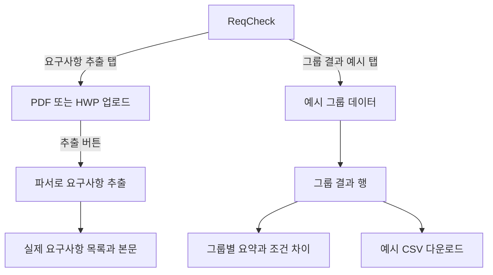
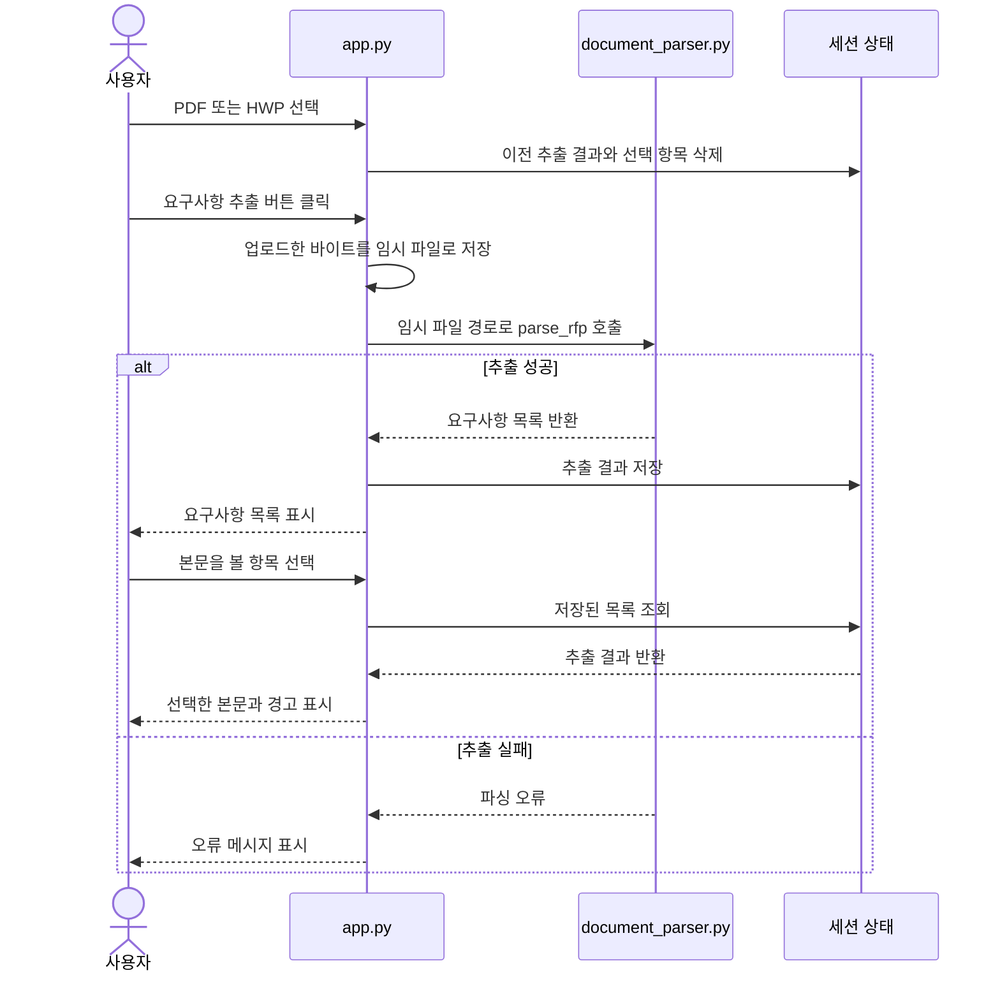

# ReqCheck 앱 실행 가이드

ReqCheck는 PDF·HWP 제안요청서를 올려 요구사항을 추출하고, 원문 번호와 위치를 확인하는 Streamlit 앱입니다. 이 문서는 **요구사항 추출**과 **그룹 결과 예시** 탭이 있는 [src/app.py](./src/app.py)를 기준으로 합니다.



실제 문서의 관계 분류·그룹화·요약과 외부 그룹 결과 JSON 입력은 모델 및 팀 데이터 형식이 준비된 뒤 연결할 작업입니다.

## 1. 처음 실행하기

VS Code에서 `enterprise-work-assistant` 폴더를 열고, 다음 파일이 보이는 프로젝트 최상위 폴더에서 터미널을 엽니다.

- `src/app.py`는 업로드 화면과 결과 화면을 실행합니다. 주석만 있는 상태라면 팀에서 공유한 구현 버전을 적용합니다.
- `src/document_parser.py`는 PDF·HWP에서 요구사항을 추출합니다.
- `pyproject.toml`과 `uv.lock`에는 프로젝트 의존성이 기록되어 있습니다.

`uv`가 설치되어 있다면 WSL 또는 PowerShell에서 아래 명령을 실행합니다. `--with streamlit`은 앱 실행에 필요한 Streamlit을 추가하고, `--locked`는 프로젝트의 잠금 파일을 확인하며 실행합니다.

```bash
uv run --locked --python 3.13 --with streamlit python -m streamlit run src/app.py
```

터미널에 표시된 **Local URL**을 브라우저에서 엽니다. **ReqCheck** 제목과 탭 두 개가 보이면 앱이 실행된 것입니다. 종료하려면 실행 중인 터미널에서 `Ctrl+C`를 누릅니다.

## 2. PDF·HWP에서 요구사항 추출하기

1. **요구사항 추출** 탭의 **제안요청서 업로드**에서 PDF나 HWP를 한 개 선택하고, 같은 업로드 영역에서 파일명을 확인합니다. 저장소의 샘플은 `src/data/input/`에서 찾을 수 있습니다.
2. **요구사항 추출** 버튼을 누릅니다. 파일을 선택한 뒤 버튼을 눌러야 추출이 시작됩니다. 처리 중에는 진행 메시지가 표시됩니다.
3. 추출이 끝나면 결과 영역에 요구사항 건수와 목록이 표시됩니다. 표에서 **추출 ID**, **원문 번호**, **원문 위치**를 확인하고, **본문을 볼 요구사항**에서 항목을 골라 정리된 본문을 읽습니다.
4. 정리 전후의 본문이 다를 때만 **정리 전 추출 본문**이 표시됩니다. 펼치면 두 본문을 대조할 수 있습니다. 선택한 항목의 경고는 본문 아래에 표시됩니다.

PDF의 `p.14`는 파일의 처음부터 센 14번째 페이지입니다. 문서에 인쇄된 쪽수와 다를 수 있습니다. HWP의 `표 20`은 파서가 추출한 표의 순번입니다. 원문에서 해당 항목을 찾을 때는 표의 **원문 번호** 열에 표시된 `QUR-01` 같은 번호로 검색합니다.

## 3. 파서 결과의 필드 이해하기

`parse_rfp()`는 요구사항 한 건을 딕셔너리로 표현하고, 여러 건을 리스트로 반환합니다. 아래 표는 각 딕셔너리에 담긴 필드를 설명합니다.

| 필드 | 예시 | 쓰임새 |
| --- | --- | --- |
| `req_id` | `REQ-001` | 파서가 문서 안에서 순서대로 붙인 ID입니다. 결과 표와 이후 그룹 연결에 사용합니다. |
| `source_req_id` | `QUR-01` | 문서에 적힌 원래 번호입니다. 원문에서 검색할 때 사용합니다. |
| `doc_name` | `제안요청서.pdf` | 업로드한 파일명입니다. |
| `doc_type` | `PDF` | 파서가 확장자로 판단한 문서 형식입니다. |
| `source_location` | `p.14` | PDF의 페이지·페이지 범위 또는 HWP의 표 순번입니다. |
| `req_text` | `사업수행 품질의 제고를 위하여 …` | 화면에 기본으로 보여주는 정리된 본문입니다. |
| `raw_req_text` | `사업수행 품질의 제고를 위하여 …` | 정리 전 추출문입니다. `req_text`와 다를 때만 **정리 전 추출 본문**에서 펼쳐 볼 수 있습니다. |
| `warnings` | `["원문/폰트 확인이 필요한 문자를 보존함: U+F09F"]` | 원문과 대조할 사항입니다. 경고가 없으면 빈 리스트입니다. |

`U+F09F` 같은 경고는 파서가 의미를 확정하기 어려운 글자를 본문에 보존했다는 뜻입니다. 앱은 기본 파서 설정을 사용합니다. 추출 건수와 본문이 표시되면 경고가 붙은 항목을 원문과 대조합니다. 샘플 PDF의 글자 치환 절차는 별도 가이드에 있습니다. [파서 실행 가이드](./guide_parser.md)

앱은 추출 결과를 화면에 표시합니다. `.requirements.json` 파일이 필요하면 파서를 CLI에서 실행합니다. [파서 실행 가이드](./guide_parser.md)

## 4. 예시 그룹과 CSV 확인하기

1. **그룹 결과 예시** 탭을 엽니다. 파일을 업로드하기 전에도 표를 볼 수 있습니다.
2. **예시 CSV 다운로드**를 누르면 `reqcheck-demo-groups.csv`를 받을 수 있습니다.
3. CSV에서 `G-001` 행의 `req_ids` 값이 `REQ-001|REQ-004`인지 확인합니다. 한 그룹에 포함된 여러 요구사항 ID를 한 셀에서 `|`로 구분합니다.

| CSV 열 | 의미 |
| --- | --- |
| `group_id` | 그룹을 구분하는 ID |
| `group_name` | 그룹의 이름 |
| `summary` | 그룹 요약 |
| `req_ids` | 그룹에 속한 요구사항의 `req_id` 목록 |
| `diff_conditions` | 그룹 안에서 다른 조건 |
| `source_locations` | 요구사항의 원문 위치 목록 |

예시 탭은 `DEMO_GROUPS`에 적힌 그룹을 표시합니다. 예시의 `REQ-001`과 업로드한 문서의 `REQ-001`은 서로 독립적인 데이터입니다. 실제 그룹 결과를 연결할 때는 같은 문서를 분석한 결과의 `req_ids`로 추출 목록을 찾아 원문 번호와 위치를 연결합니다.

## 5. 코드가 실행되는 순서



| 코드 | 하는 일 |
| --- | --- |
| `main()` | 탭을 만들고, 업로드와 추출 버튼의 입력을 받습니다. 처리 중 메시지와 실패 시 오류를 표시합니다. |
| `parse_uploaded_file()` | 업로드한 파일의 바이트를 임시 파일에 씁니다. 파일 경로를 받는 `parse_rfp()`를 호출하고, 결과의 `doc_name`을 실제 파일명으로 기록합니다. 처리 후 임시 파일은 삭제됩니다. |
| `clear_extraction()` | 파일을 바꾸거나 제거할 때, 또는 다시 추출할 때 이전 결과와 선택했던 항목을 지웁니다. |
| `render_requirements()` | 추출 건수와 요구사항 표를 표시하고, 선택한 항목의 정리된 본문과 경고를 보여줍니다. 정리 전후의 본문이 다르면 펼침 영역을 추가합니다. |
| `group_rows()` | 예시 그룹 하나를 표의 한 행으로 바꿉니다. ID와 위치 리스트를 CSV 한 셀에 담을 수 있는 문자열로 바꿉니다. |
| `group_csv()` | 같은 표 데이터를 메모리에서 CSV로 만듭니다. Excel에서 한글을 읽기 쉽도록 UTF-8 BOM을 붙입니다. |

Streamlit은 항목을 고르는 등 화면에서 입력이 바뀌면 스크립트를 다시 실행할 수 있습니다. 그래서 추출 결과를 `st.session_state["requirements"]`에 두고, 본문을 바꿔 볼 때 이미 추출한 목록을 사용합니다. [Streamlit 세션 상태 설명](https://docs.streamlit.io/develop/concepts/architecture/session-state)

## 6. 처음 실행할 때 확인할 항목

- [ ] 샘플 PDF를 올려 추출 건수와 원문 번호, 페이지, 본문을 확인합니다.
- [ ] 샘플 HWP로 바꾸면 이전 PDF 결과가 지워지고, 추출 후 HWP 표 순번이 표시됩니다.
- [ ] 목록에서 다른 항목을 골라도 추출 목록은 유지되고 본문이 바뀝니다.
- [ ] 예시 CSV를 열어 한글과 `req_ids` 열을 확인합니다.

| 증상 | 확인할 점 |
| --- | --- |
| 실행해도 탭 두 개가 보이지 않음 | 실행한 `src/app.py`가 구현 버전인지와 터미널의 Local URL을 확인합니다. |
| `No module named 'streamlit'` | 1절의 명령 전체를 실행했는지 확인합니다. |
| `No module named 'document_parser'` | `app.py`와 `document_parser.py`가 같은 `src/` 폴더에 있는지 확인합니다. |
| 파일명은 보이지만 결과가 없음 | **요구사항 추출** 버튼을 눌렀는지 확인합니다. 오류 문구가 표시되면 같은 파일을 파서 가이드의 CLI 명령으로 실행해 비교합니다. |
| PDF에서 요구사항 표를 찾지 못함 | 텍스트를 선택할 수 있는 PDF인지, 지원하는 요구사항 번호와 상세내용 표가 있는지 확인합니다. 스캔 PDF의 OCR은 현재 범위 밖입니다. |